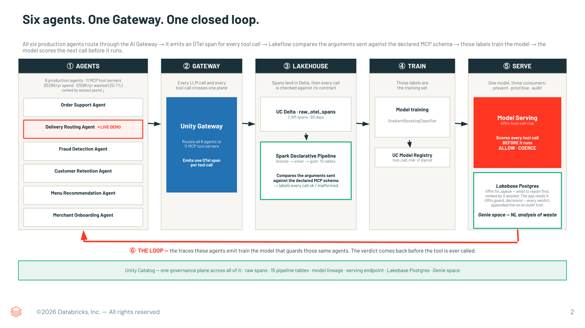
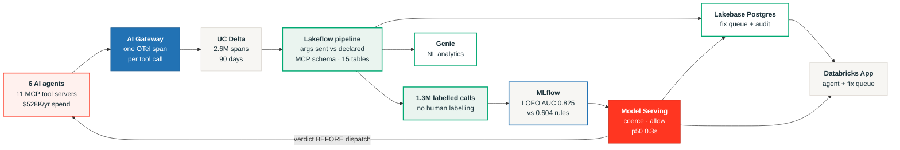
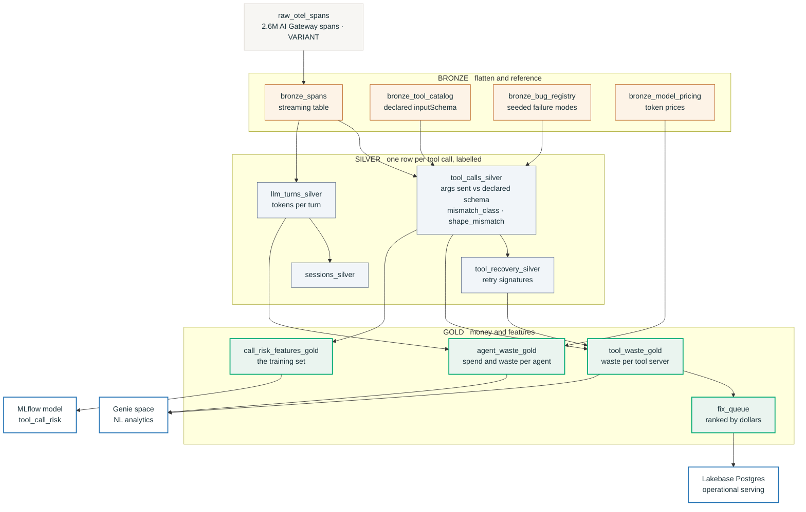

# Architecture

Five stages, left to right, with the loop closing along the bottom. The same flow is below as
Mermaid source so it is readable as text, diffable in review, and editable without a drawing
tool, followed by the medallion detail inside the Lakehouse stage.

## 1. The closed loop, as source

Source: [`architecture-overview.mmd`](architecture-overview.mmd)

The arrow back from Model Serving to the agents is the point of the project. Everything else in
this space is after-the-fact analysis. Here the traces the agents emit train the model that
guards those same agents, and the verdict arrives before the tool call is dispatched.

Unity Catalog governs every box: the raw spans, all 15 pipeline tables, model lineage, the
serving endpoint, the Lakebase project, and the Genie space.

## 2. Medallion detail

Source: [`data-flow.mmd`](data-flow.mmd)

### Where the work happens

`tool_calls_silver` is the table that matters. It joins the spans against
`bronze_tool_catalog`, which holds the `inputSchema` each MCP server declared through
`tools/list`, and compares every argument the agent actually sent against what the server said
it accepts. The output is `mismatch_class` and `shape_mismatch` per call, which is where the
1.3M training labels come from. No human labelled anything: the server's own published contract
is the ground truth.

The SQL is in [`../pipeline/03_silver_tool_calls.sql`](../pipeline/03_silver_tool_calls.sql).

### Two serving paths, on purpose

`agent_waste_gold` and `tool_waste_gold` stay in Delta and are what Genie reads, because
"how much are we wasting and where" is an analytical question over 1.3M rows.

`fix_queue` is pushed into Lakebase Postgres, because "what should my team fix first" is a point
lookup by `owner_team` that an app runs on every page view. Different access pattern, different
store, same governed numbers. The Postgres totals reconcile exactly to the Delta totals.
