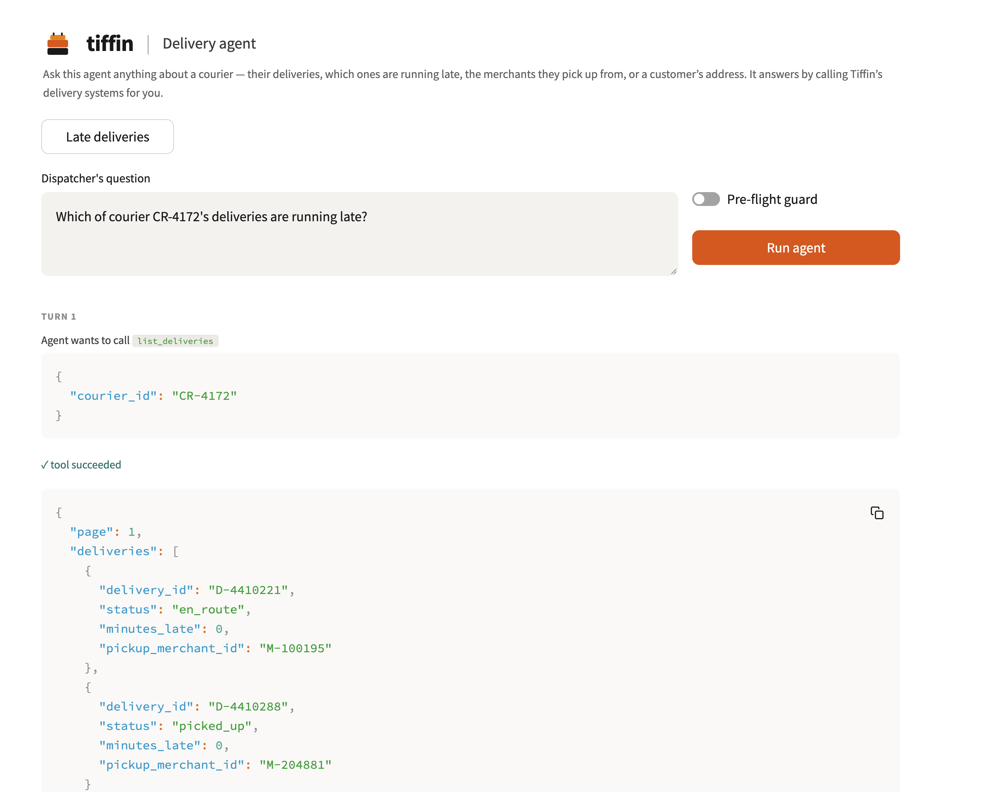
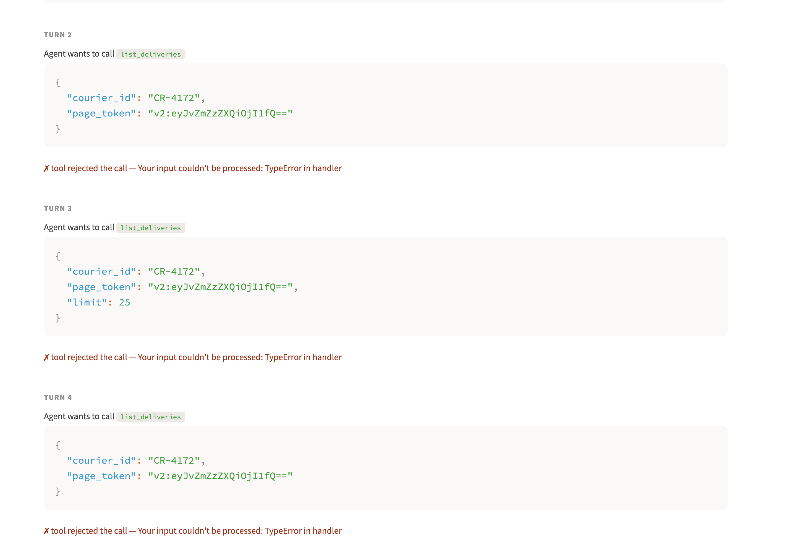
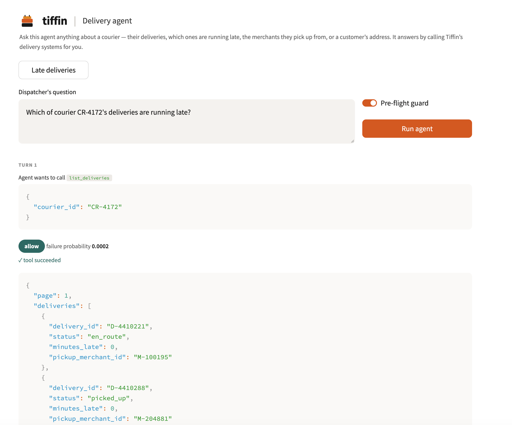
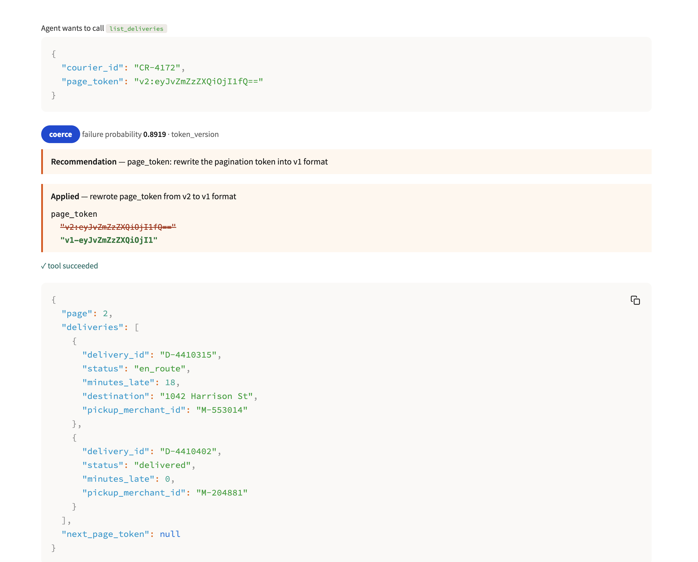

# Demo walkthrough: the same question, with the guard off and on

Screenshots from the running Databricks App. The dispatcher asks the identical question both
times:

> *"Which of courier CR-4172's deliveries are running late?"*

The answer is **D-4410315, 18 minutes late**. It sits on **page 2** of a paginated tool response,
which is the whole difficulty: reaching page 2 requires handing back a pagination token the tool
server emits in v2 format but only accepts in v1.

---

## Guard OFF

### Turn 1: the first call is fine



The agent calls `list_deliveries` with just `courier_id`. It succeeds and returns page 1, where
every delivery shows `minutes_late: 0`, plus a `next_page_token` in v2 format.

### Turns 2 to 4: the retry loop



The agent hands the token straight back, exactly as the server gave it, and the server rejects
it: `Your input couldn't be processed: TypeError in handler`. The agent then does what a
reasonable agent does. It retries the same arguments, adds `limit: 25`, drops it again. Three
rejections in a row, each one a full LLM turn.

**Every one of those rejections is an HTTP 200 response.** Nothing here would appear on an error
dashboard, and no alert would fire.

---

## Guard ON

### Turn 1: nothing to act on, so the guard stays out of the way



Same first call. The guard scores it at `failure probability 0.0002` and returns **allow**. The
call proceeds untouched. A guard that interferes with healthy calls is worse than no guard.

### Turn 2: the guard catches the malformed token before dispatch



The agent proposes the same v2 token that failed three times in the unguarded run. This time the
guard returns **coerce** at `failure probability 0.8919`, classifies it as `token_version`, and
names the offending argument:

> **Recommendation** `page_token`: rewrite the pagination token into v1 format

The wrapper applies it and shows the before and after:

```
page_token
  "v2:eyJvZmZzZXQiOjI1fQ=="     <- struck through
  "v1-eyJvZmZzZXQiOjI1"         <- what was actually sent
```

The rewrite is not a guess. It comes from the `inputSchema` the tool server itself published via
`tools/list`. The call then succeeds and returns page 2, containing `D-4410315` at
`minutes_late: 18`.

### Turn 3: the answer

The agent answers correctly and stops, in three turns:

> Courier **CR-4172** currently has one delivery running late:
>
> - **D-4410315** en route to 1042 Harrison St, **18 minutes late** (picked up from merchant
>   M-553014)
>
> The rest of their deliveries are on time.

_A screenshot of the summary panel is pending. The earlier capture showed an older version of the
comparison table, which labelled the last row "Answered the question" and therefore read
`yes / yes` for both runs. That label was the bug described below, so the screenshot was removed
rather than published next to text that contradicts it._

---

## What actually differs

| | guard OFF | guard ON |
|---|---|---|
| turns | 6 | **3** |
| tokens | 10,001 | **4,236** |
| found the late delivery | **no** | **yes** |

The token saving is real but it is the second-order benefit. The row that matters is the last
one. Unguarded, the agent never reaches page 2, so it never sees `D-4410315`.

Worth being precise about what the unguarded agent then does, because it is better behaved than
you might expect. It does not invent an answer. It says:

> *"I attempted to retrieve the next page of CR-4172's deliveries... but the pagination request
> is failing with a server-side error (`TypeError in handler`) despite several retries. I don't
> want to report an incomplete picture, so here's what I can confirm..."*

That is honest, and it is still a failure for the business: the dispatcher asked which deliveries
are running late, burned roughly 10,000 tokens, waited six turns, and **did not find out that
D-4410315 is 18 minutes late.** The courier stays late and nobody is told.

Numbers vary slightly between runs because the loop is non-deterministic: the model sometimes
gives up after fewer retries. The deterministic part is the last row. The tool server always
rejects a v2 token, so unguarded the agent never reaches page 2.

The same comparison, captured from a job run rather than the browser, is in
[`../evidence/05_agent_ab_run.md`](../evidence/05_agent_ab_run.md).
